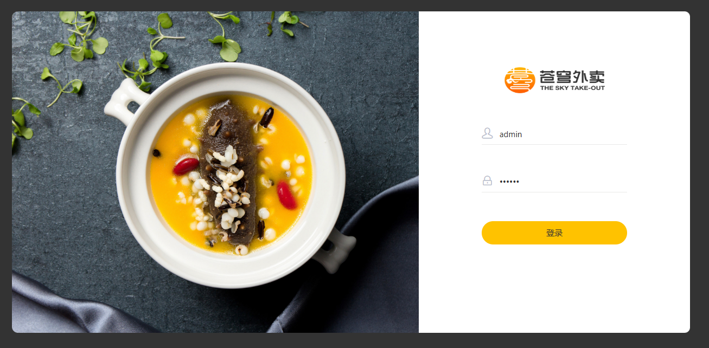
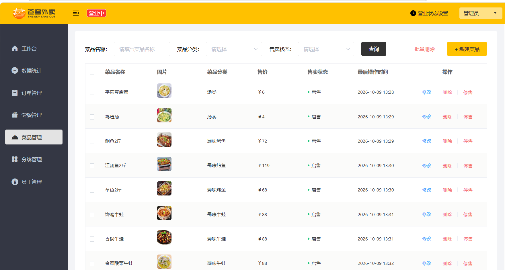
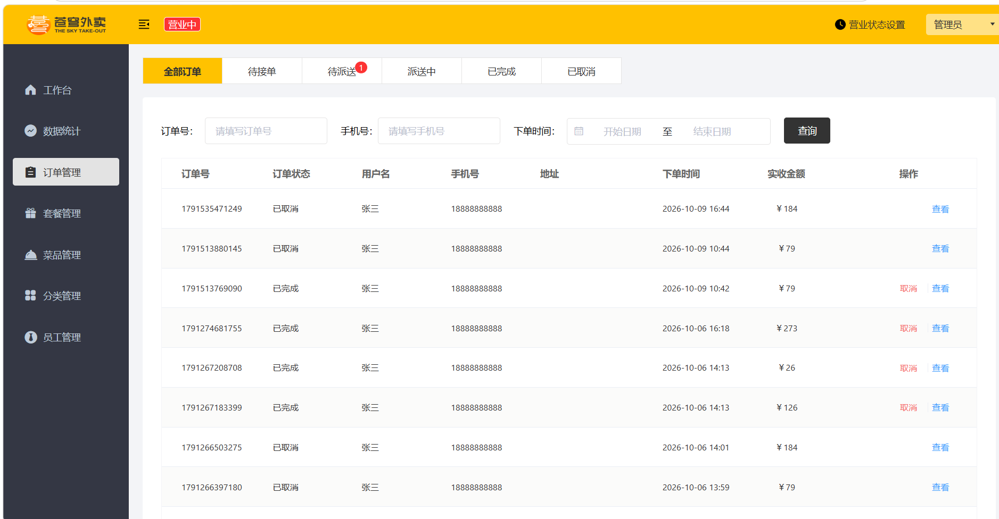
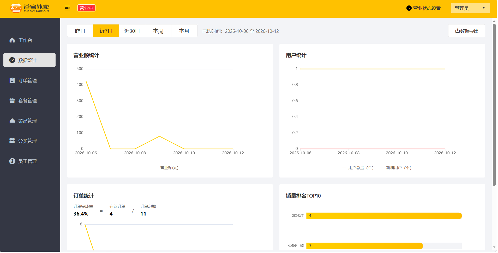
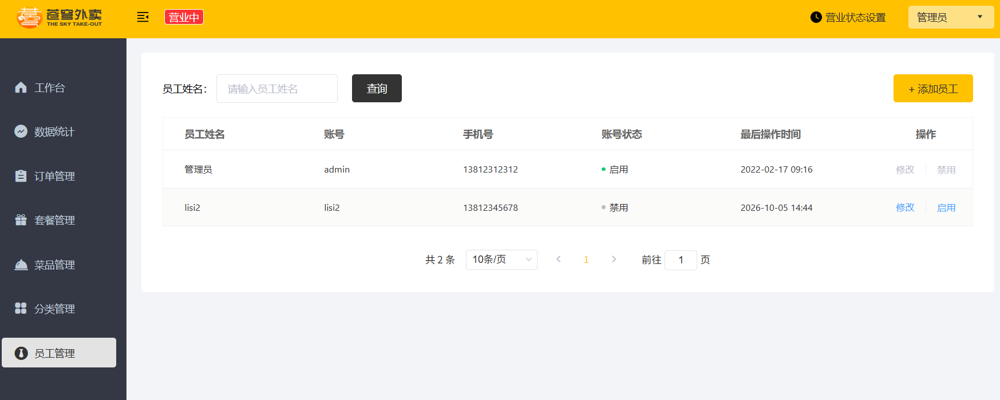
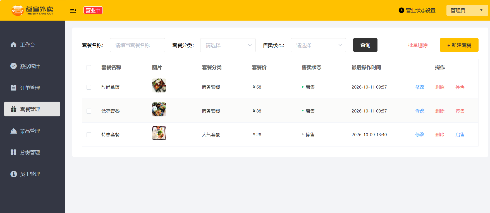
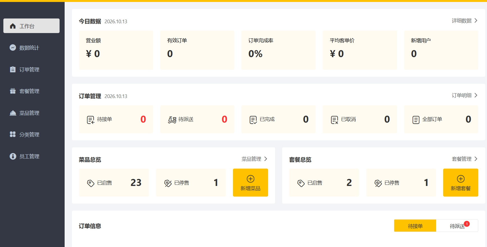

# sky-take-out

基于 Spring Boot 的外卖订餐平台，包含 **用户端（小程序/H5）** 与 **管理端（Web）** 双端功能。

## 技术栈

| 分类 | 技术 |
|------|------|
| 后端框架 | Spring Boot、MyBatis、Spring MVC |
| 数据库 / 缓存 | MySQL、Redis |
| 认证与安全 | JWT、拦截器、AOP 操作日志 |
| 实时通信 | WebSocket（来单提醒、催单） |
| 其他 | Spring Cache、Spring Task、阿里云 OSS、Apache POI、Docker、Nginx |

## 功能截图











## 核心功能

- **用户端**：菜品/套餐浏览、购物车、下单支付、订单状态查询、催单
- **管理端**：员工管理、分类管理、菜品/套餐管理、订单管理、营业状态设置、销量统计报表
- **系统功能**：
  - 使用 Redis 缓存菜品与套餐数据，设置失效策略，降低数据库压力
  - 基于 WebSocket 实现来单实时提醒与语音播报、用户催单
  - JWT + 拦截器实现无状态登录认证
  - 自定义注解 + AOP 记录管理端操作日志
  - Spring Task 定时处理超时未支付订单与派送中订单
  - 商品图片存储于阿里云 OSS

## 项目结构

```
sky-take-out
├── sky-common      # 通用模块（工具类、常量、异常处理）
├── sky-pojo        # 实体类 / DTO / VO
├── sky-server      # 核心业务模块（Controller / Service / Mapper）
```

## 如何运行

1. 准备环境：JDK 21、MySQL 8、Redis、Maven
2. 创建数据库 `sky_take_out`，执行项目中的 SQL 脚本初始化表结构
3. 修改 `application.yml` 中的数据库、Redis、阿里云 OSS 配置
4. 运行 `SkyApplication.java` 启动项目
5. 管理端访问：http://localhost:8080

## 后续迭代计划

- 购物车数据迁移至 Redis，支持未登录暂存，登录后自动合并
- 基于 Redis 分布式锁防止同一用户重复提交订单
- 新增菜品点赞/收藏功能，并纳入销量统计报表
- 员工数据权限控制：普通员工仅可操作自己创建的菜品与订单
- 引入 Docker Compose，实现 MySQL、Redis、项目一键部署
